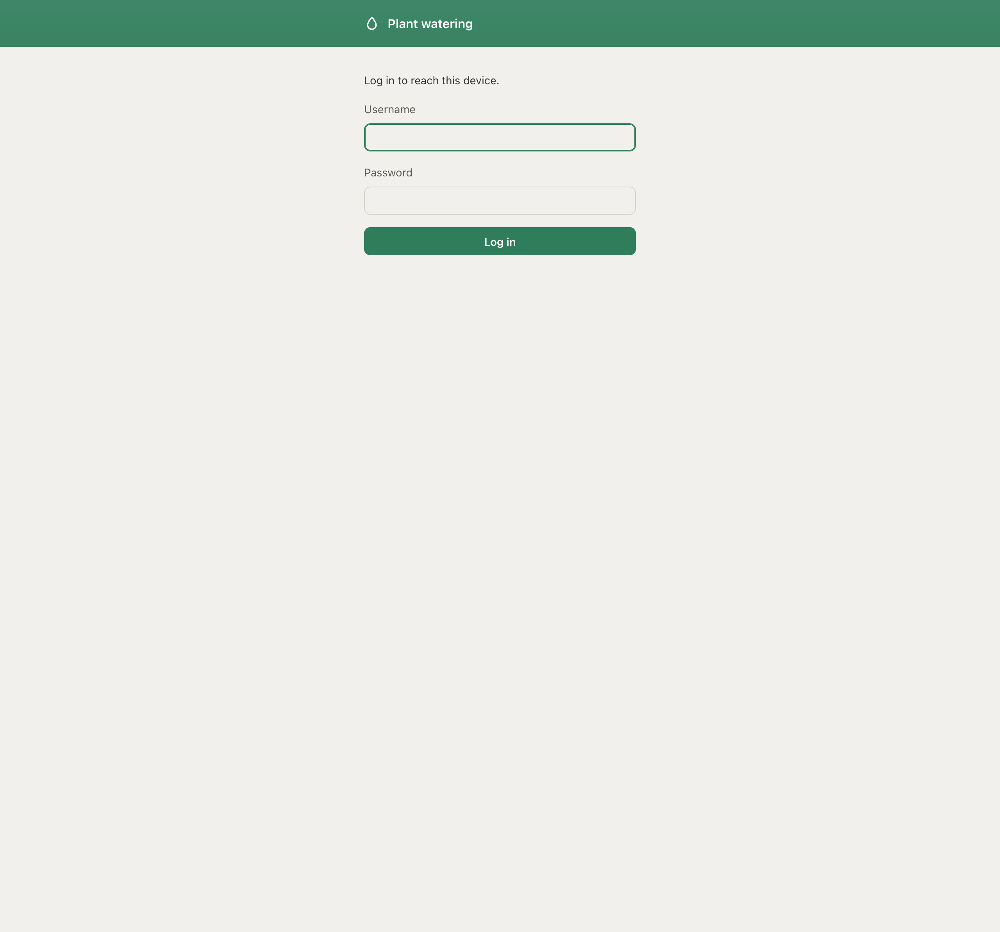
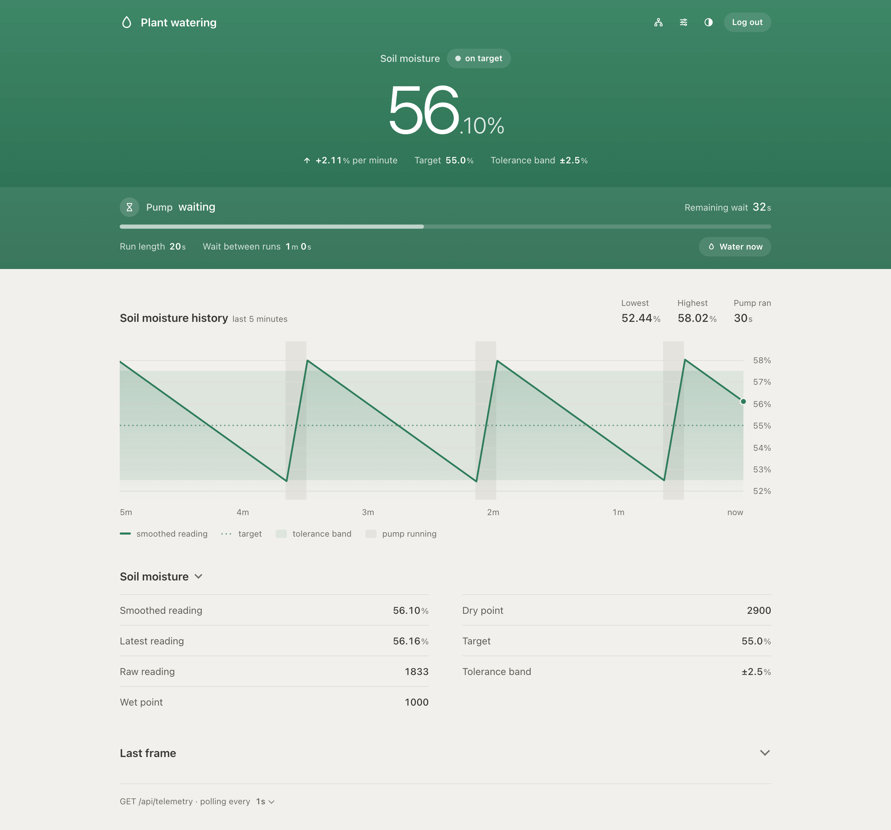

# ESP32 Plant Watering

Firmware for ESP32-family microcontrollers that monitors soil moisture and automatically controls a
water pump to maintain the desired moisture level.

Built for one moisture sensor and one pump. With the tubing split, the pump can water several
plants, but all of them are watered on the reading from the one pot the sensor sits in.

<a href="docs/login-desktop-light.png"></a>
<a href="docs/dashboard-desktop-light.png"></a>

## Quick start

With [ESP-IDF v5.5.6](https://docs.espressif.com/projects/esp-idf/en/v5.5.6/esp32c6/get-started/)
installed and an ESP32-C6 connected:

```bash
cp main/config.example.hpp main/config.hpp  # Holds credentials, pins and calibration.
. ~/esp/v5.5.6/esp-idf/export.sh
scripts/firmware.py flash
```

## Docs

- [Firmware](docs/firmware.md): chips, build profiles, flashing, stored settings, troubleshooting
- [Configuration](docs/configuration.md): messaging, WiFi roles, the dashboard, the status LED
- [Telemetry](docs/telemetry.md): the frame the device reports, field by field
- [Commands](docs/commands.md): the settings and pump requests a running device accepts
- [MQTT](docs/mqtt.md): topics, publishing and TLS
- [HTTP API](docs/http-api.md): routes, credentials, CORS, the dashboard
- [Faults](docs/faults.md): the status LED and what a code means
- [Hardware](docs/hardware.md): schematic, parts, wiring and the pin map
- [Testing](docs/testing.md): what CI checks, and running it in a container or natively
- [Code style](docs/code-style.md): naming and layout of the C++ sources

## License

MIT, see [LICENSE](LICENSE). The files under `test/host/third_party/`, and the host-test stubs under
`test/host/stubs/` that carry a notice of their own, keep the license of the project they come
from, as each file states.

ESP32 is a trademark of Espressif Systems (Shanghai) Co., Ltd. Every other product name belongs to
its owner. This project is not affiliated with or endorsed by any of them.
