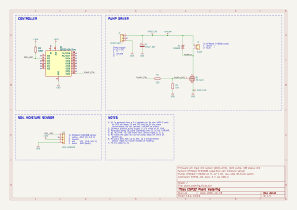

# Hardware

The reference build: an ESP32-C6-Zero reads a capacitive soil sensor and switches the pump through a
low-side MOSFET. The KiCad project is in [`hardware/`](../hardware).

> [!WARNING]
> This build puts electronics, a pump and their power supplies next to water. You build and run it
> at your own risk; the authors accept no liability for any injury or damage. This documentation
> may be incomplete or contain errors.

[`board-layout-3d.html`](board-layout-3d.html) shows where every part and wire sits on the board,
in 3D.

## Parts

| Ref | Part | Model | Qty | Specification |
|---|---|---|---|---|
| U1 | Microcontroller board | ESP32-C6-Zero | 1 | 5 V input |
| | U1 supply | USB-C adapter | 1 | 5 V DC |
| | Pump supply | | 1 | 5-12 V DC |
| | Water pump | DFRobot FIT0200 Immersible Pump & WaterTube | 1 | |
| | Soil moisture sensor | DFRobot SEN0308 Gravity: Analog Waterproof Capacitive Soil Moisture Sensor | 1 | |
| PCB | Mini solderable breadboard | | 1 | 50.8 x 38.1 mm, 2.54 mm hole pitch, 17 strips of A-E and F-J, two M3 holes |
| J1 | Pump supply connector | | 1 | 2.5 mm, 3-pin |
| J2 | Pump connector | | 1 | 2.5 mm, 2-pin |
| J3 | Sensor connector | | 1 | 2.5 mm, 4-pin |
| Q1 | MOSFET | IRLZ44N | 1 | N-channel, logic level |
| R1 | Gate series resistor | | 1 | 220 Ω |
| R2 | Gate pull-down resistor | | 1 | 10 kΩ |
| R3 | Sensor pull-up resistor | | 1 | 100 kΩ |
| D1 | Flyback diode | 1N5819 | 1 | 40 V, 1 A Schottky |
| C1 | Pump supply capacitor | | 1 | 470 µF, 35 V electrolytic |

## Wiring

| From | To |
|---|---|
| U1 3V3 | Sensor red (VCC) |
| U1 IO1 | Sensor yellow (signal) |
| U1 IO1 | R3, then U1 3V3 |
| U1 IO22 | R1, then Q1 gate |
| U1 GND | Both sensor black wires, pump supply - |
| Q1 gate | R2, then GND |
| Q1 drain | Pump blue (-), D1 anode |
| Q1 source | GND |
| Pump supply + | Pump brown (+), D1 cathode, C1 + |
| Pump supply - | GND, C1 - |

## Pin map

| Function | Pin | Setting | Notes |
|---|---|---|---|
| Soil moisture sensor | GPIO1 | `config::SENSOR_ADC_CHANNEL` | ADC1 channel 1, 12-bit, 12 dB attenuation |
| Pump | GPIO22 | `config::PUMP_PIN` | Digital output |
| Status LED | GPIO8 | `config::LED_PIN` | WS2812, onboard |

These pins are for the default ESP32-C6 target, and are set in `main/config.hpp`. On other chips the
same ADC channel may sit on a different GPIO, which the chip's datasheet lists.

## Assembly notes

- U1 runs from a 5 V adapter on its own USB-C port. Its 3V3 pin feeds the sensor and R3, and its
  5V pin stays unconnected; the pump supply goes to neither.
- The pump supply's - and U1 GND must be connected; Q1 needs the common ground.
- D1 and C1 are polarized: the diode's band (cathode) and the capacitor's + leg go to the pump
  supply +.
- Q1 (TO-220), seen from the front with the legs down: gate, drain, source, left to right.
- R2 keeps the pump off while U1 powers up. A crash or watchdog reset leaves the pump pin
  as it was, and a running pump keeps running until the firmware has started again.
- R3 pulls the sensor signal up to 3.3 V instead of leaving it floating. A disconnected sensor then
  reads above `config::SENSOR_ADC_MAX` and raises `ESEN03`, as long as `config::SENSOR_ADC_MAX`
  stays below what the unplugged sensor reads.
- C1 sits close to where the pump supply enters.

## Using another sensor

Any analog soil moisture sensor works in place of the SEN0308 if:

- Its output never goes above 3.3 V, which powering it from U1's 3V3 pin ensures.
- Drier soil reads higher. Most capacitive sensors do.
- Unplugged, it reads higher than when dry, which lets a disconnected sensor raise `ESEN03`.

`adcMin` and `adcMax` calibrate it (see [Commands](commands.md)).
